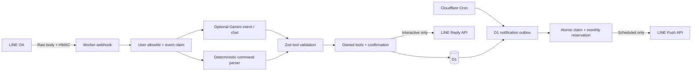

# ART AI — LINE Personal Agent

**Deploy the echo-only milestone:** follow [ECHO_DEPLOYMENT.md](ECHO_DEPLOYMENT.md) using `wrangler.echo.jsonc` and `npm run deploy:echo`. That separate entry point requires **no D1, Gemini or Cron**. The older full-MVP deployment instructions below are not the instructions for this echo-only rollout.

Repository: [Supitch-hub/kpom-agent](https://github.com/Supitch-hub/kpom-agent). To run only the echo bot locally after cloning, use `npm ci`, copy `.dev.vars.example` to `.dev.vars` only if absent, then run `npm run dev:echo`. The example uses dummy credentials and mocked LINE responses. Check `/health` locally; real LINE integration and Cloudflare deployment remain separate, unverified steps.

**Current implementation milestone: Phase 1 (echo).** `RESPONSE_MODE=echo` is now the default: authenticated, allowed text messages are echoed through LINE Reply API, command execution and scheduled pushes are disabled. See [Phase 1 setup and verification](PHASE1.md) first. The agent modules and full-MVP guide below are retained for later phases; `/task`, Gemini, reminders and briefings require explicitly selecting `RESPONSE_MODE=agent`. Do not enable that mode while validating Phase 1.

ผู้ช่วยส่วนตัวภาษาไทย/English บน Cloudflare Workers + D1 ใช้งานได้แม้ปิดคอมพิวเตอร์ ไม่มี VPS, Docker, GPU, custom domain หรือ paid LLM ที่จำเป็น ใช้ LINE Official Account เท่านั้น

Source includes strict TypeScript, real D1 migrations, validated agent tools, HMAC verification, deterministic commands, Gemini adapter, scheduled reminders, daily briefings, atomic push reservations, mock clients and Workers-runtime integration tests.

**สถานะ:** ทดสอบแบบ local ด้วย Workers runtime และ D1 emulator ได้; ยังไม่ได้ deploy หรือทดสอบกับบัญชี LINE/Gemini จริง ต้องใส่ D1 ID และ secrets ก่อน ห้ามใช้ผล local เป็นหลักฐานว่า production พร้อมแล้ว

## Architecture



```text
src/
  index.ts       HTTP routes, raw HMAC, allowlist, event idempotency
  agent.ts       authorized tools, task/note/memory actions, confirmations
  tools.ts       strict Zod schema and deterministic command grammar
  time.ts        trusted Bangkok date parsing and Buddhist Era conversion
  clients.ts     LINE/Gemini HTTP adapters and injectable mocks
  scheduler.ts   cron, briefing, transactional quota and outbox state
migrations/0001_initial.sql
tests/agent.test.ts       real D1/Workers integration and concurrency
tests/clients.test.ts     HTTP protocol and failure mocks
scripts/local-smoke.mjs   signed local webhook smoke test
wrangler.jsonc           D1 binding, variables, crons
vitest.config.ts         Cloudflare Vitest plugin
```

The model gets the current user message, tool descriptions and a trusted server timestamp. No database contents, stored notes, chat history, preferences or secrets are placed in model prompts. Gemini proposes a tool; Zod and the executor decide what can run. There are no HTTP/shell tools. Preferences are stored only after an explicit `/remember` request and confirmation; `/memory` views them and `/forget` deletes them after confirmation. This MVP does not automatically infer preferences or inject stored preferences into AI context.

## Free-tier rules and model selection

- Choose **Workers Free** and **D1 Free**. Do not upgrade plans. Each reply/push contains one text message. Cron processes at most five pending pushes per invocation; larger reminder bursts drain over subsequent minutes.
- `MAX_MONTHLY_PUSH_MESSAGES=250`, capped at 250 in code; can be lowered, including `0` to pause all proactive sends. Invalid configuration fails closed with zero allowance. Reply API calls do not consume this application push budget.
- Thai OA Free has historically offered 300 counted messages/month; verify the actual current allowance in your own OA account. Keep this OA exclusive to ART AI, disable broadcasts/other integrations, or lower ART AI's budget by a conservative allowance for their sends. The counter cannot see external sends. Official quota reconciliation is not implemented. The 250 guard is not a guarantee against account-wide charges if other tools send messages or LINE changes its plan.
- A reminder and a daily briefing each reserve one unit. 28–31 daily briefings leave roughly 219–222 reminder attempts at the default budget. Failed/uncertain attempts still consume the application's reservation. Counts are conservative attempted/reserved messages, not LINE's billing ledger. Month boundaries use Asia/Bangkok.
- `AI_ENABLED=false` by default. Deterministic commands work without Gemini. The configured candidate `gemini-2.5-flash-lite` has offered a Gemini Developer API free tier, but **current availability and your region/project eligibility were not verified here** (official documentation access was blocked). This is configurable, not a promise of current availability.
- Before enabling AI, use an **unbilled/free-tier Google AI Studio project**, check [current pricing](https://ai.google.dev/gemini-api/docs/pricing), [rate limits](https://ai.google.dev/gemini-api/docs/rate-limits), and [model lifecycle](https://ai.google.dev/gemini-api/docs/deprecations). Pick an active text model whose Free Tier input/output pricing is free; set its exact API model ID in `GEMINI_MODEL`. If the candidate has retired, replace it. Do not attach billing or enable a paid fallback. There is no automatic paid model switch or API retry.
- Supplying an API key alone does not prove free eligibility; model-list API does not report pricing. A key on a billed project can incur charges if you enable AI. The application cannot inspect your billing eligibility. Free-tier prompts may be used by Google to improve products: avoid sensitive inputs.
- Cloudflare Free limits (CPU, daily requests, D1 rows/storage) and LINE/Gemini quotas still apply. Bursts can delay notifications. This is a personal single-user MVP, not an SLA or an unlimited service. Load/CPU profiling against real cloud accounts remains a deployment acceptance check.

Reference docs: [Workers limits](https://developers.cloudflare.com/workers/platform/limits/), [D1 limits](https://developers.cloudflare.com/d1/platform/limits/), [LINE sending messages](https://developers.line.biz/en/docs/messaging-api/sending-messages/), [LINE retry keys](https://developers.line.biz/en/docs/messaging-api/retrying-api-request/).

## Windows setup (PowerShell)

Install Node.js **24 LTS**, Git and a browser. `winget` commands below are optional if already installed:

```powershell
winget install OpenJS.NodeJS.LTS
winget install Git.Git
# Open a NEW PowerShell after installation.
node --version
npm.cmd --version
git clone https://github.com/Supitch-hub/kpom-agent.git
cd kpom-agent
# If this source was supplied as files, open PowerShell in that folder instead.
npm.cmd ci
npm.cmd run typecheck
npm.cmd test
Copy-Item .dev.vars.example .dev.vars
npm.cmd run db:local
npm.cmd run dev
```

Never commit `.dev.vars`, tokens, or keys. The local example enables mocked clients and uses dummy credentials, so it never sends LINE messages or calls Gemini. `MOCK_CLIENTS=true` is for local development only. Production config defaults to false.

In a second PowerShell in the project folder:

```powershell
node scripts/local-smoke.mjs
npx.cmd wrangler d1 execute art-ai --local --command "SELECT title,COUNT(*) AS n FROM tasks WHERE title='LOCAL_SMOKE_TEST' GROUP BY title;"
npx.cmd wrangler d1 execute art-ai --local --command "SELECT status,COUNT(*) AS n FROM processed_line_events GROUP BY status;"
# On a fresh local DB, expect one smoke task and one 'done' event, despite 2 deliveries.
# Each repeat of the smoke script creates one NEW task/event.
# Optional cron simulation (local only):
Invoke-WebRequest 'http://127.0.0.1:8787/__scheduled?cron=*+*+*+*+*' -UseBasicParsing
```

Do not give LINE the localhost URL. A real LINE webhook needs the deployed HTTPS Workers URL. `wrangler dev` is only for development; deployment and Cron run without your computer.

## Remote D1, secrets and deployment

These commands change your Cloudflare account. Review configuration first. Keep all projects/plans on free tiers. No live credentials were created or used during generation.

```powershell
npx.cmd wrangler login
npx.cmd wrangler whoami
npx.cmd wrangler d1 create art-ai
```

Copy the returned `database_id` into `wrangler.jsonc` replacing `00000000-0000-0000-0000-000000000000`. Keep binding `DB` and database name `art-ai`. This UUID is nonsecret. If Cloudflare asks about a paid plan, stop and review rather than accepting an upgrade.

```powershell
npm.cmd run db:remote
# Deploy deterministic mode first: AI_ENABLED=false, MOCK_CLIENTS=false.
# Until all secrets exist, the webhook returns 503; it does not accept users.
npm.cmd run deploy
npx.cmd wrangler secret put LINE_CHANNEL_SECRET
npx.cmd wrangler secret put LINE_CHANNEL_ACCESS_TOKEN
npx.cmd wrangler secret put LINE_ALLOWED_USER_ID
# Only needed for AI; enter its value through Wrangler's secret prompt:
npx.cmd wrangler secret put GEMINI_API_KEY
npm.cmd run deploy
```

Paste secret values **only at the Wrangler prompts**, never into tracked files, screenshots, chat or command arguments. Access token is always a Cloudflare secret in production. The allowed LINE user ID is also a secret as requested. `.dev.vars` is only local test configuration and is not deployed by Wrangler.

Verify with the actual URL printed by Wrangler:

```powershell
# Replace YOUR_SUBDOMAIN with the one returned by Wrangler.
Invoke-RestMethod 'https://art-ai.YOUR_SUBDOMAIN.workers.dev/health'
# Expected: ok=True, database=ok. This does NOT probe LINE/Gemini credentials.
```

To enable AI after confirming free eligibility and active model availability, set `AI_ENABLED` to `"true"` and `GEMINI_MODEL` to the verified model ID in `wrangler.jsonc`, then `npm.cmd run deploy`. Test a normal Thai and English sentence via LINE. 429, missing key, retirement, timeout or invalid model output falls back to deterministic commands. No task success is reported unless a database write returned successfully.

Verify the two Cron Triggers in Cloudflare dashboard: `* * * * *` for reminders and `30 1 * * *` for 08:30 Bangkok. Trigger propagation may take several minutes. The minute handler checks `DAILY_BRIEFING_TIME` too; its unique local-date key prevents duplication if both triggers fire. Storage timestamps are UTC. This version supports only `TIMEZONE=Asia/Bangkok`; do not change it without implementing and testing another timezone. If you change briefing time, use `HH:mm` Bangkok and update the dedicated UTC trigger too (the minute trigger also handles it).

Network destinations from deployed Worker: `api.line.me` and `generativelanguage.googleapis.com`. Development also uses `registry.npmjs.org` and Cloudflare APIs/login. A restricted Codex cloud environment may need these domains allowed in its settings; its proxy settings are not deployed to Workers.

## LINE OA manual checklist

1. Create a LINE Official Account in the **Thailand** region and verify its current free message allowance. Keep Free plan and avoid enabling paid auto-upgrades.
2. Enable Messaging API through LINE Official Account Manager. Open the associated provider/channel in [LINE Developers Console](https://developers.line.biz/console/).
3. Copy **Channel secret** and issue a **Channel access token (long-lived)** for the Messaging API channel. Store each with the corresponding `wrangler secret put` command above. Never use a LINE Login channel's credentials.
4. Obtain your personal **user ID** (`U...`) from the channel Basic settings when available, or a securely inspected signed test event during a separate controlled setup. Do not disable the allowlist or log raw production webhook bodies to discover it. Store it as `LINE_ALLOWED_USER_ID`.
5. Add the OA as a friend from your personal LINE account. Block group/room participation where OA settings allow it; the Worker rejects group/room sources regardless.
6. Set Webhook URL to `https://art-ai.YOUR_SUBDOMAIN.workers.dev/webhook/line`, click **Verify**, then enable **Use webhook**. Empty verification events are supported.
7. Disable built-in auto-response/greeting flows or other bots that would duplicate replies/use proactive quota. Avoid manual broadcasts on this OA unless you reduce ART AI's push budget.
8. Enable webhook redelivery if desired; the Worker deduplicates by webhookEventId, falling back to message ID. Reply tokens are never reused.
9. Send `/help`, `/task ทดสอบ`, `/tasks` from the allowed account. Another user must get no response (HTTP 403). Confirm `/status` shows push usage at zero after interactive commands.
10. Send `/remind ทดสอบแจ้งเตือน | อีก 2 นาที`. Leave the computer off, wait a few minutes, confirm one push and `/status` reservation +1. Observe one briefing at 08:30 Bangkok. Do not call local cron simulations against production.

## Commands and time grammar

| Command | Example / behavior |
|---|---|
| `/help` | Help in Thai + English |
| `/task title [\| when]` | `/task จ่ายค่าไฟ \| พรุ่งนี้ 09:00` creates task and due reminder |
| `/tasks` or `งาน` | Up to 25 pending tasks; includes full UUIDs |
| `/done UUID` | Complete an owned task; cancels pending reminder |
| `/edit UUID \| title` | Rename task and unsent reminder text |
| `/due UUID \| when` | Replace due date/reminder on an incomplete task |
| `/delete UUID` | Stage deletion; `/confirm` required |
| `/note text` | Save personal note |
| `/search text` | Literal substring search, up to 10 results |
| `/remind message \| when` | Standalone reminder |
| `/remember key \| value` | Explicit preference, requires confirmation |
| `/memory` | View preferences |
| `/forget key` | Delete preference, requires confirmation |
| `/confirm` / `ยืนยัน` | Execute latest staged operation once within 5 minutes |
| `/cancel` / `ยกเลิก` | Clear pending operation |
| `/status` | D1 health, AI enabled state, conservative monthly push count, uncertain notifications |

Use full UUIDs, not list positions. Thai text gets Thai responses; Latin command inputs generally get English responses. Listing preserves the user's original task/note language. Freeform chat uses the message language via Gemini, Thai by default.

Supported time examples: `วันนี้ 18:30`, `พรุ่งนี้ 09:00`, `มะรืน 10:00`, `พรุ่งนี้ ๙ โมงเช้า`, `พรุ่งนี้ บ่าย 2 โมงครึ่ง`, `อีก 30 นาที`, `อีก 2 ชั่วโมง`, `อีก 1 วัน`, `tomorrow 09:00`, `in 30 minutes`, `31/12/2569 09:00`, `2026-12-31 09:00`. Explicit dates may use Buddhist Era (year ≥2400 subtracts 543). Thai and Arabic digits work. Relative days mean elapsed 24-hour periods in Bangkok, which has no DST.

Missing times default to a **proposed** 09:00; time-only inputs propose today or tomorrow; vague `เช้า/บ่าย/เย็น` propose 09:00/13:00/18:00. These require confirmation and show the resolved timestamp. Past/invalid dates, named months, weekdays and unsupported wording ask for a supported expression. Nothing is silently scheduled from an unrecognized date. Confirmed time is stored as an absolute timestamp, not reparsed later. An expired/past proposal is not executed. Only the latest staged confirmation is retained.

## Delivery guarantees and recovery

`processed_line_events` claims each event with a unique primary key **before** any action. Concurrent redeliveries cannot execute it twice. Side effects and the external Reply API are not one transaction: a crash can leave a completed mutation without a reply. The event remains claimed/uncertain and is not automatically replayed. Check `/tasks` before retrying. Events older than 50 seconds are acknowledged without running actions because reply tokens normally expire in about one minute. Batches above five events / bodies above 64 KiB are rejected. Up to five events run concurrently to keep normal replies prompt (Gemini timeout 8s, LINE timeout 7s). No interactive Push fallback is allowed.

Scheduler enqueues due reminders transactionally and briefings uniquely by `(user, Bangkok date)`. Outbox states are `pending → claimed → uncertain → sent`, with `failed` for definitive LINE rejections. One D1 batch atomically inserts the month, conditionally claims an eligible pending notification below budget, and increments its reservation. Concurrent jobs cannot exceed the budget. The code marks an attempt uncertain before network IO and sends a UUID retry key to LINE. A successful response becomes sent; network errors/5xx/crashes remain uncertain. Claimed rows older than five minutes also become uncertain. **Failed or uncertain rows never retry or refund automatically.** Pending rows held by budget may send in a later month, potentially late.

Exactly-once external delivery is impossible: LINE might accept a request but lose its response, or a crash might occur before sending. This MVP favors no automatic duplicates/overspend over guaranteed delivery. A task completed/deleted/rescheduled while its notification is already claimed may still receive an in-flight push; pending notifications are cancelled. Briefings reflect the snapshot when queued.

For recovery, inspect outbox metadata in Cloudflare D1 console. Do not mass-reset states or decrement quota. If an uncertain reminder is important, ask the user whether it arrived, then create a new reminder explicitly; it reserves another unit. Confirmed permanent auth failures require fixing secrets and creating a new reminder. This avoids accidental repeated charged requests.

Tables: `users` (pending confirmation), `tasks`, `notes`, `reminders`, `user_preferences`, `processed_line_events`, `notification_outbox`, `monthly_message_usage`, `agent_logs`. Due dates and pending queues are indexed. User ownership is checked on every task operation. Logs contain category/code/timestamps only, no raw text, user IDs, prompts or credentials. Event identifiers are retained 35 days, logs 7 days, cleaned in bounded cron batches. Tasks/notes/preferences/outbox are retained until explicitly managed; periodic D1 backups/retention review are the account owner's responsibility. This MVP has no note-delete command or full-account deletion UI.

## Acceptance and troubleshooting

Required automated checks:

```powershell
npm.cmd ci
npm.cmd run typecheck
npm.cmd test
npx.cmd wrangler deploy --dry-run --outdir .wrangler/build
```

Tests must execute (not zero tests): raw signatures, forbidden sources, concurrent duplicate webhooks, task CRUD/ownership, Thai/English/BE dates, ambiguous confirmations/expiry, notes/preferences, Gemini malformed/429 fallback, real adapter HTTP shapes with mocks, reminder scheduling, quota contention across same/distinct notifications and Bangkok months, stale/uncertain no-retry handling, cancellation, briefing uniqueness. Tests use real local D1 in Workers runtime, not a SQL string imitation.

Required live acceptance (unverified until you configure accounts):

- `/health` returns 200 with migrated D1; LINE Verify succeeds.
- Allowed account gets replies; unauthorized/group/room input cannot mutate D1.
- A signed redelivery creates one task and one reply attempt.
- Tasks/notes/preferences behave as the commands specify; Gemini-disabled operation works.
- After free eligibility verification, a Thai and English natural-language request maps to the correct validated tool; AI quota errors leave deterministic commands working.
- One reminder push arrives with computer off; reservations increment before sending; budget zero blocks all pushes.
- One briefing arrives at 08:30 Bangkok despite overlapping triggers; over-budget/uncertain states do not send automatically.
- Confirm free-plan CPU/DB/request limits under your expected usage in Cloudflare dashboard and actual LINE count/plan allowance in OA Manager.

| Symptom | Check / action |
|---|---|
| PowerShell blocks npm.ps1 | Use `npm.cmd` and `npx.cmd` as shown; do not loosen execution policy |
| Local tests cannot start Workerd | Use Node 24 LTS; `npm.cmd ci`; close stale local dev instances; allow local runtime networking in your development environment |
| `/health` 503 | Correct D1 binding/ID, run remote migrations, check Workers logs without dumping secrets |
| Webhook 401 | Messaging API channel secret matches; verify body wasn't reformatted by a proxy; header is `x-line-signature` |
| Webhook 403 | Correct personal `U...` user; groups/rooms deliberately rejected |
| Webhook 503 | Required LINE secrets missing; configure and redeploy |
| Reply missing but task exists | Single-use/expired reply token or transport failure; check task first, never replay event blindly |
| AI fallback | AI_ENABLED, key, active model/free region, 429; `/help` works independently |
| No reminder | Follow OA; correct allowed user and access token; check UTC due_at, Cron propagation, outbox state and monthly reservation |
| Failed/uncertain push | Fix auth/quota or inspect whether delivered; no automatic retry/refund |
| Wrong time | All input/display Bangkok; database UTC; use explicit date + time and confirm proposal |
| Cannot clone repo | Check the repository URL and your GitHub repository access |

Health/status do not send a paid probe and do not certify remote credentials. Deployment, LINE/Gemini live tests and new cloud-task snapshot restoration are separate checks; no successful deployment is claimed by this repository alone.
